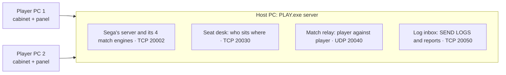

<p align="center">
  
</p>

<p align="center">
  <a href="https://github.com/Forza-WCCF/WCCF-Kit-1011/actions/workflows/kit.yml"></a>
  
  
  
</p>

<p align="center">
  <a href="https://github.com/Forza-WCCF/WCCF-Kit-1011/releases/latest"><b>Download the latest kit</b></a>
  &nbsp;·&nbsp; <a href="/README.txt">The guide</a>
  &nbsp;·&nbsp; <a href="/CHANGELOG.md">What changed</a>
</p>

Community-developed launcher, hardware compatibility tools and an in-game panel for **WCCF 2010-11 (Rev D)**. With your own copy of the game, it runs the game's server, the projector (the shared big screen) and a player cabinet on one Windows PC - or lets several PCs play on one server - and puts a panel around the game's picture with the cabinet's buttons, your cards and your club.

> **The game is not included, and the kit holds none of Sega's files.** It works with your own copy: what it needs from the game, SETUP makes from that copy, on your PC.

## New in Kit 7

- **Play online with a wccf.online account** - sign in once with a short code; online you play your account's own club, kept on wccf.online, starting with 11 cards and earning a card for every finished match.
- **Buttons that never stop** - a short freeze of the kit's I/O helper could leave the game ignoring every button until it was closed; now a freeze costs only the moment it lasts.
- **More player against player** - a router changing the game's port at kick-off no longer turns the match into a CPU match, the server pairs any two free players at random, and two players in one house both get their cards.
- **More English** - the "please wait for the next match" line between matches, and an honest notice: Sega's network is closed.

Every change, kit by kit: [CHANGELOG.md](/CHANGELOG.md).

## What you get

| | |
|---|---|
| **One launcher** | `PLAY.exe` starts everything: on your own PC the server, the projector and your cabinet; online, only your cabinet |
| **Formation board** | your cards on the table: drag to move, drop on another card to swap, right-click to take one off |
| **Catalogue** | all 3,909 player cards: search, position, rarity, country and club filters, sorting, a slider per stat |
| **Keys** | your own keys, or a game controller's buttons |
| **Club card** | your club as the game reads it, more than one club, safe saves with backups, CLEAR BAD ENDINGS |
| **Languages** | English (about 7,200 lines of screen text, the players' names, money in dollars) or Italiano - built from your own game files |
| **Online play** | one PC hosts, the others join; matches between players go through the host, so nobody installs anything else |
| **A wccf.online account** | online, your own club kept on [wccf.online](https://wccf.online): 11 starter cards and a card for every finished match |

## Quick start

1. **You need** Windows 10 or 11 (64-bit), your own copy of the game (Rev D) as a folder of files, and DirectX 9 (Microsoft's June 2010 runtime; SETUP tells you if it is missing).
2. **Download the kit** from [Releases](https://github.com/Forza-WCCF/WCCF-Kit-1011/releases/latest) and unzip it into a folder of its own.
3. **Drag your game folder onto `SETUP.exe`** (the one that holds `client_Release.exe`), or open `SETUP.exe` and pick it. It checks your copy is Rev D, sets it up and makes the card catalogue (about a minute).
4. **Double-click `PLAY.exe`.** Click the cabinet's window and play with the keyboard. To quit, close the game's window.
5. Optional, in `SETUP.exe`: **GAME LANGUAGE** (English or Italiano), and **UPDATE** to move to a newer kit - your clubs, keys and settings stay.

Every key, setting and panel is explained in [README.txt](/README.txt), the guide that comes with the kit.

## Play online

```text
PLAY.exe server                  on the PC that hosts: the server only, in the background
PLAY.exe remote 192.168.1.20     on each player's PC, with the host's address
```

Or in the game: SETTINGS > NEXT START > **ONLINE**, type the server's address, then **RESTART NOW** (click it twice).

- The host lets in **TCP 20002, 20030 and 20050** and **UDP 20040** (at home behind a router: forward them to the host).
- Each PC runs only its own cabinet - online there is no projector window on the players' PCs.
- The host can play too: `PLAY.exe remote` with its own local address.
- **Your wccf.online account:** the first online start shows a short code and opens wccf.online - log in or register, approve the code, and the game starts. Online you play your account's own club; without a sign-in, PLAY plays on your PC instead.



## When something goes wrong

- **SEND LOGS** (in SETTINGS) sends your PC's logs to the server whose address is in SETTINGS and gives you a code to quote.
- **Online, a crash or a lost connection sends them by itself** to the server you were playing on, with a memory snapshot if the game crashed - so the cause can be found without asking you. If that server cannot be reached then, your next online start sends it. To switch this off: a line `auto_logs=0` in `data\panel.txt`.
- **Never your club card.** Your Windows user name and your PC's name are blanked out of everything that is sent.
- Everything also stays on your PC: `data\logs` and `data\dumps`.

## The kit's folders

| | |
|---|---|
| `PLAY.exe` · `SETUP.exe` | start the game · set it up, update it, choose the language |
| `code\` | the kit's Python: starting and stopping, the cabinet's stand-ins, cards, online |
| `programs\` | the compiled parts: the hook in the game (`wccfk.dll`), the panel, the card table's helper |
| `art\` · `languages\` | the panel's picture · the English and Italian tables |
| `python\` | the Python that comes with the kit - nothing to install |
| `data\` | yours: club cards, keys, settings, logs - kept through every update |
| `source\` | how every program is built, and the checks |

In this repository every folder also has a `HANDOFF.md`: one line per file, and what is fragile. Start at [HANDOFF.md](/HANDOFF.md).

## For developers

Git holds the source; GitHub builds the programs and the kit ZIP.

| Script | Does |
|---|---|
| `source\build.ps1` | builds every program: the hook, the panel and the card table's helper (C, 32-bit MSVC) and PLAY and SETUP (Rust) |
| `source\check.ps1` | every check that needs no game: the scripts, the key driver, the seat desk, the card reader, SEND LOGS, a deliberate crash, the panel's self-tests |
| `source\package.ps1` | the kit ZIP in `dist\`, exactly as players get it |

You need Visual Studio 2022 (or its Build Tools) with "Desktop development with C++", and rustup. Every push to main and every pull request runs all three on GitHub ([kit.yml](/.github/workflows/kit.yml)). A release is drafted from main (a `kit-*` tag, or Run workflow with a release tag) and played in the real game before it is published. Changes go in through pull requests; see [CHANGELOG.md](/CHANGELOG.md). How Kit 6 was planned and tested: [docs/REDESIGN.md](/docs/REDESIGN.md).

---

<p align="center">Made by the WCCF community: <a href="https://github.com/flack0x">flack0x</a> and <a href="https://github.com/peakxl">peakxl</a>, Forza-WCCF</p>
